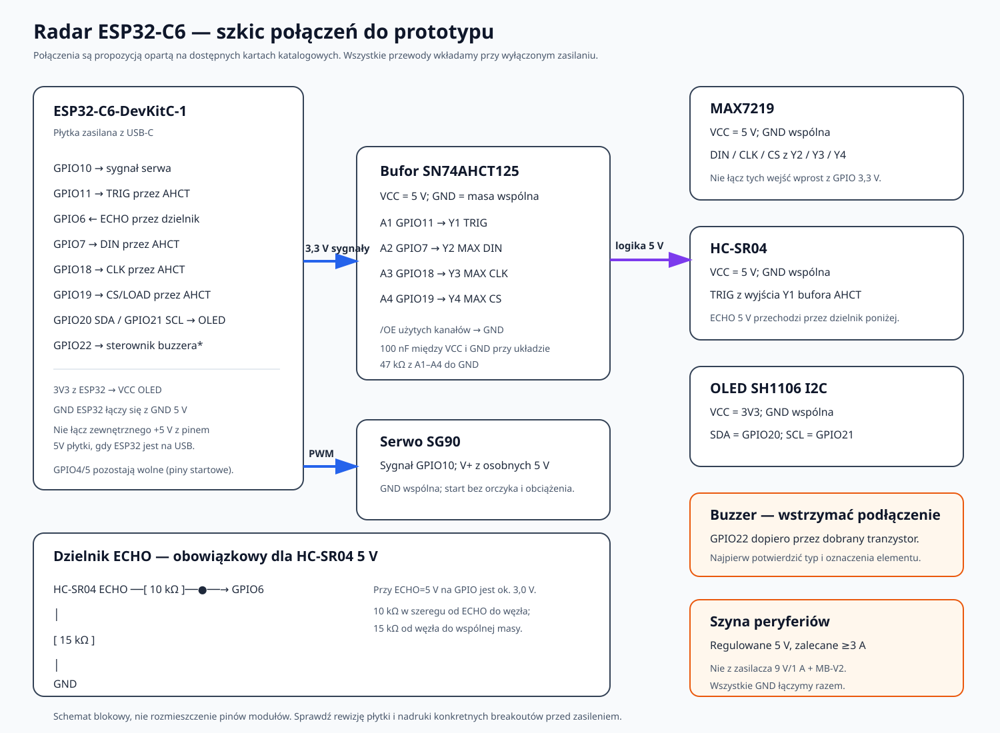
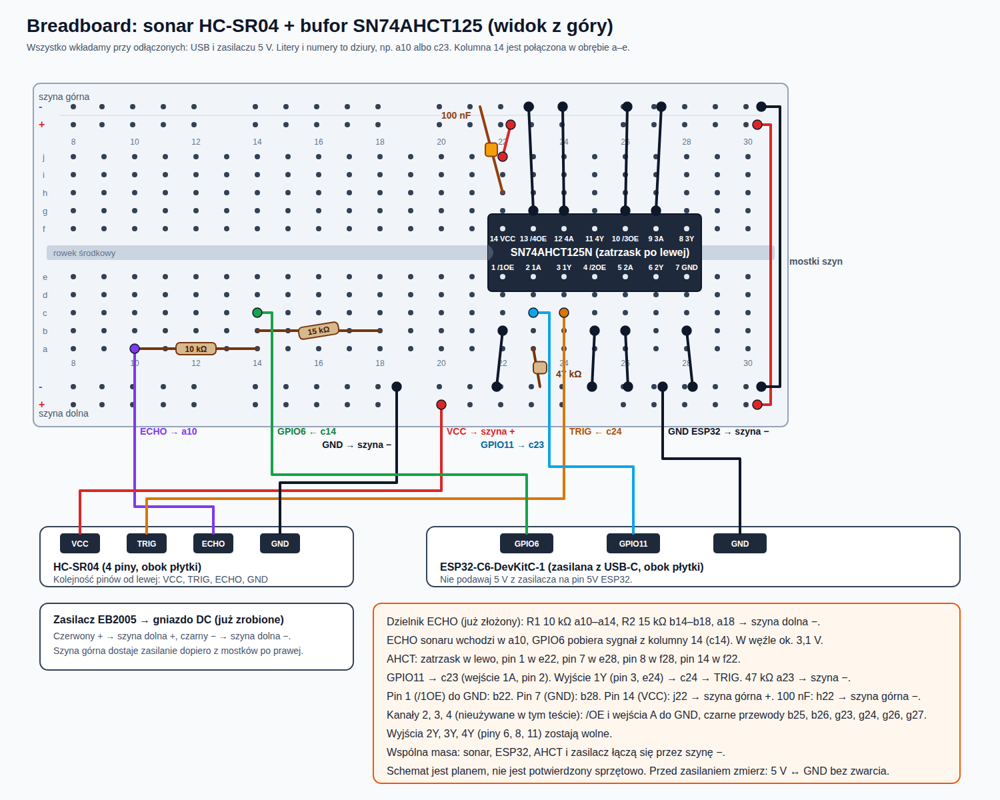

# Plan podłączenia i testowania radaru

Ten dokument przygotowuje bezpieczną kolejność pracy dla zestawu: ESP32-C6-DevKitC-1,
serwo SG90, HC-SR04, OLED SH1106 1,3 cala I2C, matryca MAX7219, buzzer pasywny
i system Zigbee2MQTT/Home Assistant.

## Co sprawdzono i co nadal zależy od konkretnej sztuki

- Espressif podaje GPIO4 i GPIO5 jako piny startowe (strapping). Firmware został
  przestawiony z GPIO4/5 na GPIO10/11 dla serwa i TRIG; pozostałe przypisania
  są wymienione niżej. GPIO10/11 są wyprowadzone na nagłówku DevKitC-1.
- ESP32-C6 pracuje z logiką 3,3 V. Datasheet podaje maksymalnie 3,6 V na wejściach
  oraz minimalny poziom logicznej jedynki równy 0,75 × VDD. Żaden sygnał 5 V nie
  może iść bezpośrednio na GPIO.
- Typowy HC-SR04 jest zasilany z 5 V i wystawia ECHO jako impuls 5 V. Proponowany
  dzielnik 10 kΩ/15 kΩ obniża impuls do ok. 3,0 V przy ECHO=5 V. Rezystor 10 kΩ
  łączy ECHO z wejściem węzła GPIO; 15 kΩ łączy ten węzeł z GND.
- MAX7219 zasilany z 5 V wymaga według karty katalogowej co najmniej 3,5 V na
  wejściu logicznym HIGH. Poziom 3,3 V z ESP32 nie jest gwarantowany. W szkicu
  dlatego jest bufor SN74AHCT125 zasilany z 5 V (AHCT rozpoznaje wejście 3,3 V
  jako HIGH i daje wyjście 5 V). Sam układ MAX7219 wymaga też rezystora RSET
  ustawiającego prąd LED; przed włączeniem trzeba potwierdzić, że breakout go ma.
- SG90 wymaga zasilania zewnętrznego. Dla serwa przyjmujemy regulowane 5 V,
  osobną od ESP32 gałąź zasilania i wspólną masę. Zasilacz 9 V/1 A z modułem
  Elegoo Power MB V2 nie jest przewidziany do zasilania serwa: dostępny arkusz
  MB-V2 podaje maksymalnie 700 mA. Rzeczywiste wymagania prądowe zależą od
  konkretnego serwa i obciążenia.
- Moduły SH1106 i MAX7219 występują w różnych wersjach. Bez zdjęcia nadruków
  na obu stronach konkretnego modułu nie można potwierdzić ich zasilania,
  rozmieszczenia pinów ani obecności rezystorów podciągających/elementów
  ochronnych. OLED w tym planie zasilamy z 3,3 V, nie z 5 V.
- Dla zakupionego zasilacza uniwersalnego instrukcja potwierdza polaryzację
  końcówki beczkowej: plus w środku, minus na zewnątrz. Nadal nie potwierdza to
  rzeczywistego napięcia ani prądu przy ustawieniu 5 V. Co ważniejsze, zdjęcia
  opakowania pasują do opisu modelu „Universal Adapter 30W / 12W” w raporcie
  bezpieczeństwa brytyjskiego OPSS nr 2207-0381. Raport opisuje ryzyko porażenia
  prądem z powodu dostępnych części pod napięciem i informuje o wycofaniu
  produktu ze sprzedaży. Dopóki nie potwierdzimy, że to inny produkt, nie używać
  ani nie podłączać tego adaptera do gniazdka. Do projektu wybrać inny,
  sprawdzony zasilacz 5 V o odpowiedniej wydajności prądowej.
- Kupiony zasilacz MW Power EB2005 ma stałe wyjście 5 V / 4 A / 20 W
  i plus w środku. Oryginalny wtyk 5,5 × 2,1 mm nie pasował do kupionego gniazda,
  więc wymieniono go na wtyk 5,5 × 2,5 mm z innego zasilacza (polaryzację i brak
  zwarcia sprawdzono multimetrem; szczegóły w uwadze przy zakupach poniżej). Karta
  katalogowa potwierdza 20 W; spotykany w tytule oferty zapis 24 W jest niespójny z 5 V × 4 A. Użyjemy go tylko do
  zasilania peryferiów, a ESP32 podczas programowania pozostanie zasilane z USB.
- **Do sprawdzenia przy zakupach:** wtyk zasilacza i gniazdo DC muszą mieć ten sam
  rozmiar (średnica zewnętrzna × otwór środkowego pinu, np. 5,5 × 2,1 albo
  5,5 × 2,5 mm). Opis oferty i etykieta zasilacza go nie zawsze podają, a wtyk
  2,1 mm może luźno siedzieć w gnieździe 2,5 mm. Kupiony EB2005 miał wtyk, który nie
  pasował do gniazda 2,5 mm, więc podmieniono go na wtyk ze starego zasilacza.
  Po takiej wymianie zawsze zmierzyć: brak zwarcia między środkiem a obudową,
  napięcie i polaryzację na zaciskach gniazda (dla EB2005: 5,14 V bez obciążenia,
  plus w środku). Wymieniony wtyk pochodzi z adaptera oznaczonego do weryfikacji
  (ostrzeżenie OPSS), tylko wtyk jest używany, nie sam adapter.
- **ESP32-C6-DevKitC-1(-N8) poza płytką stykową (decyzja 2026-10-08):** próba
  wciśnięcia płytki w breadboard (63 kolumny) wymagała dużej siły przy 2 × 16
  pinach (schemat v1.4: listwy J1 i J3 to `CON16X1_2P54`, nie 2 × 22), a
  zniszczone styki płytki stykowej psułyby też już zbudowane zworki. ESP32 zostaje
  obok, a do płytki idą tylko trzy przewody Dupont żeńsko-męskie: GPIO6, GPIO11
  i GND. Rozstaw rzędów goldpinów sprawdzono przykładając płytkę, pasuje do
  breadboardu.
- **Adapter z zaciskami śrubowymi, zakup 2026-10-08:** „Adapter do ESP32 30 pin
  Devkit V1 z zaciskami ARK terminal” (2 × 15 pinów, rozstaw rzędów wg opisu
  24 mm). C6-DevKitC-1 ma 2 × 16 pinów, więc **nie pasuje bez sprawdzenia**:
  na każdej stronie jeden pin wystaje poza gniazda, a zgodność rozstawu rzędów
  trzeba zmierzyć na własnej płytce. Nadruki na spodzie płytki (zdjęcie
  2026-10-09, rewizja **ESP32-C6-DevKitC-1 V1.2**) potwierdzają 16 pinów na
  listwę, a pin **NC leży na końcu od strony USB-C na obu listwach**. Licząc od
  końca z anteną: J1 pin 1 to 3V3, pin 5 to GPIO6, pin 11 to GPIO11, pin 15 to
  G, pin 16 to NC; J3 pin 1 to G. Wszystkie potrzebne sygnały mieszczą się więc
  w 15 pozycjach, jeśli płytkę ułoży się od strony anteny. Zmierzona długość
  jednej listwy to 38 mm (15 rozstawów po 2,54 mm); **rozstaw między rzędami**
  (środek do środka) nadal trzeba zmierzyć i porównać z 24 mm podanymi dla
  adaptera. Pomiar płytki suwmiarką: **23,9 mm między zewnętrznymi krawędziami
  pinów** obu rzędów (przy pinie ok. 0,64 mm to ok. 23,3 mm środek–środek).
  **Temat adaptera zaparkowany (2026-10-09):** adapter jeszcze nie dotarł,
  dostawa planowana na sobotę 2026-10-10. Po odbiorze zmierzyć odległość między
  zewnętrznymi krawędziami obudów jego żeńskich listw i porównać z tą samą
  wartością zmierzoną na płytce; różnica do ok. 0,3 mm jest bezpieczna, powyżej
  ok. 0,6 mm nie wciskać na siłę i rozważyć zwrot.
  **Nie wciskać ESP32 w adapter przed porównaniem układu bez nacisku** (nałożyć
  płytkę nad gniazdami i sprawdzić, czy oba rzędy trafiają w gniazda).
  **Przed zakupem adaptera zawsze sprawdzać:** liczbę pinów na stronę (C6: 16),
  rozstaw rzędów i opis zgodności z konkretnym modelem płytki.
- Buzzer nie ma znanego numeru części. Dlatego jego końcowy obwód jest oznaczony
  jako do potwierdzenia: nie podłączamy nieznanego buzzera bezpośrednio do GPIO.

To jest szkic połączeń oparty na znanych modelach, nie potwierdzony testem
sprzętowym. Należy sprawdzić nadruki i napięcia przed podaniem zasilania.

## Potrzebne elementy do bezpiecznego prototypu

- **Kupione:** zasilacz MW Power EB2005, 5 V / 4 A / 20 W, wtyk 5,5 × 2,5 mm
  (po wymianie), plus w środku. Zasila zewnętrzną szynę peryferiów; nie podłączaj
  jego plusa do pinu 5V ESP32, gdy płytka jest zasilana z USB;
- **Kupione, dostawa w czwartek:** układ Texas Instruments SN74AHCT125N
  w obudowie DIP-14 i podstawka DIP-14. Układ zasilamy z tej samej szyny 5 V;
- kondensator ceramiczny 100 nF przy układzie SN74AHCT125N;
- rezystory 10 kΩ i 15 kΩ do dzielnika ECHO (zalecana tolerancja 5% lub lepsza);
- cztery rezystory 47 kΩ do utrzymania wejść AHCT w stanie niskim przy
  wyłączonym ESP32;
- **Kupione:** gniazdo DC 5,5 × 2,5 mm z wyjściem śrubowym lub inny pewny rozdzielacz do
  przewodów; sprawdzić jego obciążalność i nie prowadzić prądu serwa przez
  delikatne styki breadboardu;
- multimetr; opcjonalnie oscyloskop lub analizator logiczny do obserwacji ECHO,
  spadków zasilania i zakłóceń;
- jumpery i breadboard o dobrym styku; przed włączeniem sprawdzić, że szyny
  zasilania na breadboardzie nie są przerwane w połowie.

EB2005 ma zapas względem wstępnego wymagania 5 V / 3 A. Rzeczywiste napięcie
i spadki podczas ruchu serwa sprawdzimy multimetrem przy testach; zasilacz
podłączymy przez właściwe gniazdo/rozdzielacz DC, nie bezpośrednio do GPIO.

## Przypisanie sygnałów

| Funkcja | Pin ESP32-C6-DevKitC-1 | Połączenie |
|---|---:|---|
| PWM serwa | GPIO10 | Sygnał serwa; zasilanie serwa osobno z 5 V |
| Sonar TRIG | GPIO11 | Przez kanał SN74AHCT125 do TRIG |
| Sonar ECHO | GPIO6 | Przez dzielnik 10 kΩ/15 kΩ do GPIO6 |
| Matryca DIN | GPIO7 | Przez kanał SN74AHCT125 |
| Matryca CLK | GPIO18 | Przez kanał SN74AHCT125 |
| Matryca CS/LOAD | GPIO19 | Przez kanał SN74AHCT125 |
| OLED SDA | GPIO20 | I2C, zasilanie OLED 3,3 V |
| OLED SCL | GPIO21 | I2C, zasilanie OLED 3,3 V |
| Buzzer | GPIO22 | Tylko przez odpowiedni stopień tranzystorowy po identyfikacji buzzera |



### Układ na breadboardzie: sonar i bufor TRIG (stan na 2026-10-09)



Wersja wektorowa: `breadboard-sonar-layout.svg`. Litery a–e to dolna połowa
płytki, f–j górna; kolumna o danym numerze jest połączona tylko w obrębie połowy.
SN74AHCT125N stoi okrakiem nad rowkiem: pin 1 w e22, pin 7 w e28, pin 8 w f28,
pin 14 w f22 (zatrzask po lewej).

| Połączenie | Dziura / miejsce | Status |
|---|---|---|
| R1 10 kΩ | a10 – a14 | złożone |
| R2 15 kΩ | b14 – b18 | złożone |
| Koniec dzielnika | a18 → szyna dolna − | złożone |
| ECHO z HC-SR04 | a10 | złożone |
| GPIO6 z ESP32 | c14 (węzeł dzielnika), przewód Dupont | do zrobienia |
| GPIO11 z ESP32 | c23 (pin 2, 1A), przewód Dupont | do zrobienia |
| TRIG do HC-SR04 | c24 (pin 3, 1Y) | złożone |
| SN74AHCT125N | pin 1 w e22, pin 14 w f22 | złożone |
| /1OE (pin 1) | b22 → szyna dolna − | złożone |
| GND układu (pin 7) | b28 → szyna dolna − | złożone |
| VCC układu (pin 14) | j22 → szyna górna + | zmierzone 5,12 V (pin 14 ↔ pin 7), 2026-10-09 |
| 100 nF | h22 → szyna górna − | złożone |
| 47 kΩ na 1A | a23 → szyna dolna − | złożone |
| Nieużywane kanały 2–4 | b25, b26, g23, g24, g26, g27 → GND | złożone |
| Mostki szyn | dolna + → górna +, dolna − → górna − | zmierzone: szyna górna 5,13 V (2026-10-09) |
| VCC sonaru | szyna dolna + | złożone |
| GND sonaru | szyna dolna − w kolumnie 14 | złożone |
| GND ESP32 | szyna dolna −, przewód Dupont | do zrobienia |

Stan „złożone” pochodzi z relacji użytkownika z 2026-10-09; nie był jeszcze
sprawdzony pod napięciem ani multimetrem poza pozycjami opisanymi w dzienniku.

Podczas montażu: najpierw układ bez zasilania, potem multimetrem sprawdzić brak
zwarcia 5 V ↔ GND i dopiero włączyć zasilacz. Szyna górna zmierzona 2026-10-09: 5,13 V.

### Szczegóły połączeń i zasilania

1. ESP32 zasilaj z USB-C podczas programowania. Nie podawaj zewnętrznego 5 V na
   pin 5V płytki, kiedy jest podłączona do USB. Instrukcja Espressifa opisuje te
   metody jako wzajemnie wykluczające się.
2. EB2005 zasila serwo, HC-SR04, moduł MAX7219 i SN74AHCT125; połącz wspólnie
   GND zasilacza i GND ESP32. Nie podłączaj plusa EB2005 do pinu 5V DevKitC-1,
   kiedy płytka jest zasilana z USB. Nie podłączaj EB2005 do wejścia Elegoo
   Power MB V2, które wymaga wyższego napięcia wejściowego.
3. OLED podłączamy do 3V3, GND, GPIO20/SDA i GPIO21/SCL. Zasilenie typowego
   modułu OLED napięciem 5 V może podciągnąć SDA/SCL do 5 V i uszkodzić ESP32.
   Trzeba potwierdzić, że moduł działa przy 3,3 V i ma właściwy interfejs I2C.
4. Dzielnik ECHO: HC-SR04 ECHO → rezystor 10 kΩ → węzeł → GPIO6; węzeł → rezystor
   15 kΩ → GND. Masa sonaru i ESP32 musi być wspólna. Nie pomijamy dzielnika.
5. Cztery kanały SN74AHCT125 mogą podać poprawną logikę 5 V na TRIG i trzy
   wejścia matrycy. Zasilanie układu: VCC=5 V, GND=wspólna masa, wszystkie cztery
   wejścia `/OE` podłącz do GND, żeby bufory były stale włączone. `/OE` jest
   aktywne stanem niskim, więc podciągnięcie go do plusa wyłączyłoby wyjście.
   Każde wejście A1–A4 połącz przez 47 kΩ do GND, aby nie wisiało w powietrzu,
   gdy ESP32 jest wyłączone. Umieść kondensator 100 nF blisko VCC/GND układu.
   Piny niewykorzystane, jeśli breakout różni się od wariantu 14-pinowego,
   podłącz zgodnie z kartą konkretnego układu.
6. Matryca MAX7219 dostaje 5 V i GND z zewnętrznej szyny. Jej DIN/CLK/CS dostają
   wyjścia bufora AHCT, nie GPIO bezpośrednio. Nie stosujemy L293D ani 74HC595
   jako konwerterów poziomów.
7. Serwo: przewód sygnałowy → GPIO10; czerwony/zasilanie → zewnętrzne 5 V;
   masa → wspólna GND. Kolory przewodów są typowe, ale należy sprawdzić oznaczenia
   i pinout własnego egzemplarza. Na początku zdejmujemy orczyk i nie obciążamy
   serwa mechanicznie.
8. Buzzer pozostaje odłączony do identyfikacji. Po identyfikacji dobieramy
   tranzystor i rezystor bazy/bramki. Dioda zabezpieczająca jest potrzebna przy
   buzzerze elektromagnetycznym/cewce, nie zakładamy jej bez ustalenia typu.

## Kolejność testów

### A. Przygotowanie i kontrola bez napięcia

1. Spisać rewizję DevKitC-1 oraz zrobić czytelne zdjęcia przodu i tyłu OLED,
   MAX7219, buzzera i Power MB V2. Sprawdzić nazwy i polaryzację złącz.
2. Nie używać sfotografowanego adaptera uniwersalnego ze względu na możliwe
   dopasowanie do ostrzeżenia OPSS. Użyj kupionego EB2005 jako osobnego zasilania
   peryferiów. Zasilacza 9 V/1 A nie podłączać do żadnego pinu ESP32 ani
   bezpośrednio do serwa.
3. Ustawić firmware na GPIO10/11 (zrobione w `src/app_config.h`) i skompilować
   poleceniem `$HOME/.platformio/penv/bin/pio run`. Przejść testy hostowe detektora
   i sterowania skanowaniem:

   ```sh
   gcc -std=c11 -Wall -Wextra -Werror -Isrc src/detector.c tests/test_detector.c -o /tmp/test_detector && /tmp/test_detector
   gcc -std=c11 -Wall -Wextra -Werror -Isrc src/scan_control.c tests/test_scan_control.c -o /tmp/test_scan_control && /tmp/test_scan_control
   ```
4. Przy wyłączonym zasilaniu zbudować tylko dzielnik ECHO i bufor AHCT. Omomierzem
   sprawdzić brak zwarcia między 5 V, 3,3 V i GND oraz poprawne połączenia mas.

### B. Testy modułów osobno

1. Włączyć sam ESP32 z USB. Sprawdzić log startowy i brak restartów.
2. Bez ESP32, włączyć wybrany zasilacz peryferiów bez obciążenia i multimetrem
   potwierdzić 5 V oraz polaryzację. Zasilacz wyłączyć.
3. Podłączyć OLED do 3,3 V/I2C. Uruchomić ekran i sprawdzić wykrycie adresu
   oczekiwanego przez kod (0x3C). W razie problemu sprawdzić nadruki, I2C/SPI
   jumpery i adres modułu.
4. Podłączyć HC-SR04: zasilanie 5 V, TRIG przez AHCT, ECHO przez dzielnik.
   Najpierw sprawdzić, że węzeł GPIO nie może osiągnąć 5 V; następnie wykonać
   serię pomiarów płaskiej, twardej przeszkody w znanej odległości. Nie używać
   tkaniny ani miękkiej powierzchni jako pierwszego celu.
5. Podłączyć matrycę MAX7219 przez AHCT. Sprawdzić obraz przy małej jasności,
   stabilne napięcie 5 V i brak przegrzewania modułu/bufora. Nie włączać układu
   MAX7219, jeśli nie potwierdzono obecności właściwego rezystora RSET.
6. Podłączyć serwo jako ostatnie z urządzeń mocy. Zostawić zdjęty orczyk, zacząć
   od środka i krótkich ruchów. Obserwować 5 V i logi ESP32 pod kątem brownoutów,
   resetów i drgań. Nie blokować mechanicznie serwa.
7. Dopiero po poznaniu modelu buzzera dołączyć tranzystorowy sterownik i sprawdzić
   go osobno.

### C. Test całego radaru

1. Przy kompletnym okablowaniu włącz najpierw zewnętrzne 5 V, a dopiero potem
   USB ESP32. Przed wyłączeniem odłącz najpierw USB, potem 5 V. Nie przepinaj
   przewodów przy włączonym zasilaniu.
2. Uruchomić patrol bez buzzera i sprawdzić ruch serwa w zakresie projektu
   (15–165°), prawidłowe wskazania OLED/matrycy i brak kolizji mechanicznej.
3. Zmierzyć kilka znanych odległości; sprawdzić brak celu, wykrycie celu,
   zanik celu i alarm krytyczny. Powtórzyć z serwem zatrzymanym, aby oddzielić
   błędy sonaru od drgań i hałasu zasilania.
4. Dopiero po stabilnym teście lokalnym uruchomić Wi-Fi i MQTT; sprawdzić status,
   scan, dostępność urządzenia, encje Home Assistant i polecenia przełączników.
5. Włączyć Zigbee2MQTT `permit_join`, uruchomić urządzenie, zaakceptować je,
   sprawdzić encje pomiarów, alarmów, progów, patrolu i buzzera, a następnie
   sterowanie w obie strony. Sprawdzić, że zły próg nie zostaje przyjęty.
6. Wykonać kilka restartów i dłuższy test pracy. Po każdym zmianie przewodów
   wyłączyć wszystkie zasilania i odłączyć USB.

Testy opisane powyżej nie zostały jeszcze wykonane na fizycznym sprzęcie.

## Dziennik pomiarów sprzętowych

Wpisy dotyczą tylko rzeczy faktycznie zmierzonych lub sprawdzonych na stole.

### 2026-10-07: zasilanie peryferiów i dzielnik ECHO

- **Zasilacz EB2005:** 5,14 V DC bez obciążenia (multimetr UNI-T UT33B+,
  zakres 20 V DC). Plus w środku wtyku, minus na obudowie.
- **Wtyk:** wymieniony na 5,5 × 2,5 mm (patrz uwaga przy zakupach powyżej).
  Test ciągłości środek–obudowa: krótki pisk przy ładowaniu kondensatorów
  zasilacza, potem stale OL, czyli brak zwarcia.
- **Gniazdo DC 5,5 × 2,5 mm z zaciskami śrubowymi:** podpisy + i − na zaciskach
  zgodne z pomiarem polaryzacji multimetrem.
- **Szyna breadboardu:** zaciski gniazda połączone do bocznej szyny (+ czerwona,
  − niebieska). Bez ESP32 i modułów: 5,13 V przy wejściu przewodów oraz 5,13 V na
  drugim końcu szyny, czyli szyna jest ciągła.
- **Dzielnik ECHO (częściowo złożony, bez zasilania):** zmierzone multimetrem:
  R1 9,77 kΩ (−2,3%), R2 14,71 kΩ (−1,9%), a10–b18 razem 24,5 kΩ (suma 24,48 kΩ,
  więc połączenie szeregowe przez kolumnę 14 jest poprawne). Obliczone napięcie
  węzła GPIO6 przy 5,13 V: ok. 3,08 V (limit 3,3 V), nie zmierzone pod zasilaniem.
  R1 10 kΩ: a10 – a14. R2 15 kΩ: b14 – b18 (poprawione 2026-10-08 według stanu faktycznego).
  a18 podłączone do szyny −. Do dołączenia: ECHO HC-SR04 do a10, GPIO6 do kolumny 14
  (c14 lub d14).
- **Nie zrobiono jeszcze:** SN74AHCT125N (dostawa w czwartek), kondensator 100 nF,
  podłączenie ESP32, HC-SR04, OLED, MAX7219, serwa i buzzera.

### 2026-10-09: bufor TRIG i sonar złożone, bez ESP32

- **Stan według relacji użytkownika:** wszystko z etapu „sonar i bufor TRIG” jest
  złożone na płytce: SN74AHCT125N, kondensator 100 nF, rezystor 47 kΩ, przewody
  GND i VCC układu, wszystkie przewody nieużywanych kanałów, mostki szyn,
  VCC i GND sonaru, ECHO (a10) i TRIG (c24). GND sonaru jest wpięty w szynę
  dolną − w kolumnie 14.
- **Zostało z tego etapu:** podłączenie ESP32 trzema przewodami Dupont (GND,
  GPIO6 do c14, GPIO11 do c23). ESP32 zostaje poza płytką stykową.
- **Nie zmierzone:** napięcie szyny górnej po mostkach (oczekiwane ok. 5,1 V),
  zasilanie układu AHCT pod napięciem, brak zwarć 5 V ↔ GND po całym montażu.
- **Nie testowano sprzętowo:** pomiar odległości, sygnał TRIG i ECHO, praca
  z firmware.

### 2026-10-09: test zwarcia 5 V ↔ GND po montażu (bez zasilania)

- **Wynik według relacji użytkownika:** multimetr w trybie ciągłości nie
  zapiszczał we wszystkich trzech pomiarach, czyli brak zwarcia: (1) szyna dolna
  + ↔ −, (2) szyna górna + ↔ −, (3) VCC ↔ GND układu AHCT (pin 14 ↔ pin 7).
  Odczytu w omach nie podano. Zasilacz i USB odłączone (wg uzgodnionej procedury).

### 2026-10-09: zasilanie płytki włączone (ESP32 i USB odłączone)

- **Pomiary:** szyna górna + ↔ − **5,13 V**; szyna dolna + ↔ − **5,13 V**;
  VCC układu AHCT, pin 14 ↔ pin 7, **5,12 V**.
- **Obserwacja użytkownika:** nic niepokojącego (bez nagrzewania i zapachu).
- **Wniosek:** mostki szyn przewodzą, układ AHCT dostaje 5 V. Zmierzone zostały
  też W3, W4, W7 i W8 w modelu (pośrednio, przez napięcie).
- **Nie testowano:** TRIG i ECHO, ESP32, pomiar odległości.

### 2026-10-09: trzy przewody Dupont od ESP32 podłączone (bez zasilania)

- **Stan według relacji użytkownika:** GND ESP32 → B-@15 (szyna dolna −),
  GPIO6 → c14 (węzeł dzielnika ECHO), GPIO11 → a23 (kolumna 23: wejście 1A
  bufora i rezystor 47 kΩ do GND; a23 i c23 to ta sama sieć). Plan zakładał
  GND w B-@27 i GPIO11 w c23; zmiany nie wpływają na działanie.
- **Zostało:** po sprawdzeniu połączeń włączyć USB-C, potem zasilacz zgodnie
  z kolejnością z listy „Przy kompletnym okablowaniu” (najpierw 5 V, potem USB), i wykonać pomiar odległości.
- **Pomiary przy wyłączonych zasilaczu i USB (ESP32 podpięte kablami):**
  GND ESP32 ↔ szyna dolna −: ciągłość (OK). GND ESP32 ↔ szyna dolna +: brak
  ciągłości (OK). GPIO6 ↔ GND: **14,7 kΩ** (zgodnie z R2 = 14,71 kΩ). GPIO11 ↔
  GND: **50,6 kΩ**. GPIO6 ↔ szyna dolna +: **34,8 kΩ**.
- **Interpretacja:** GPIO6 ↔ GND zgadza się z R2. GPIO11 ↔ GND jest wyższe niż
  47 kΩ (R3 mógł być 51 kΩ albo wchodzi tolerancja i układ pomiarowy); dla
  pull-downa na wejściu bufora każda wartość 10–100 kΩ jest wystarczająca.
  Wartość 34,8 kΩ między GPIO6 a + jest mniejsza niż zakładałem. **Hipoteza
  (niepotwierdzona):** to R1 (9,77 kΩ) plus rezystancja wewnętrzna wyjścia ECHO
  sonaru do jego VCC (ok. 25 kΩ, typowy słaby pull-up klonów HC-SR04). Nie jest
  to zwarcie, a przy 5 V węzeł GPIO6 zostaje w granicach dzielnika (ok. 3 V).
- **Pomiary pod napięciem 5 V (zasilacz włączony, USB ESP32 odłączone):**
  c14 (węzeł GPIO6/dzielnik) ↔ GND **0 V**; a23 (wejście TRIG bufora) ↔ GND
  **0 V**; c24 (wyjście bufora do sonaru) ↔ GND **0 V**. To stan spoczynkowy
  (ECHO nisko, TRIG nisko). Bez uwag użytkownika o grzaniu lub zapachu.
- **Nie zmierzone / nie testowane:** napięcie w węźle GPIO6 podczas impulsu
  ECHO, TRIG i ECHO w ruchu, pomiar odległości, praca z firmware.

### 2026-10-09: pierwszy pomiar odległości HC-SR04 (program testowy, ESP32 z USB, 5 V z EB2005)

- **Co uruchomiono:** minimalny program `hardware/firmware-tests/sonar-bench/`
  (tylko TRIG GPIO11 i ECHO GPIO6, pomiar co 500 ms, bez serwa, OLED, matrycy i
  sieci), wgrany z Asusa przez COM5 (esptool 5.5.0, `Hash of data verified`).
- **Wynik:** odczyty 9–10 cm przy nieruchomym przedmiocie, kilka wartości
  6–13 cm podczas jego ruchu i jeden `no echo (timeout)`. Według użytkownika
  odczyt odpowiada odległości zmierzonej od czoła czujnika do przeszkody
  (liczbowej wartości nie podano; dokładność nie jest zmierzona).
- **Wniosek:** tor TRIG (ESP32 → AHCT → sonar) i tor ECHO (sonar → dzielnik →
  ESP32) działają funkcjonalnie, a ESP32 przeżył pracę z dzielnikiem. Nie
  zmierzono napięcia w węźle GPIO6 w trakcie impulsu ECHO (z rachunku ok. 3,1 V).
- **Test dokładności (relacja użytkownika, miarka od czoła czujnika):**

  | Sonar | Miarka | Różnica |
  |---|---|---|
  | 130 cm | 131 cm | −1 cm |
  | 21 cm | 20 cm | +1 cm |
  | 52 cm | 52 cm | 0 cm |
  | 107 cm | 107 cm | 0 cm |

  Różnice mieszczą się w ±1 cm, czyli w rozdzielczości programu (zaokrąglenie do
  pełnych cm) i w niedokładności ustawienia miarki. Test czterech punktów na jednym
  celu; nie jest to pełna charakterystyka (inne kąty, powierzchnie, temperatura).
- **Nie testowano:** zasięgu poniżej 20 cm i powyżej 130 cm, odbić od skośnych
  lub miękkich celów, OLED, MAX7219, serwa, buzzera, pełnego firmware.

### 2026-10-09: oględziny modułu OLED (zdjęcia przodu i tyłu)

- **Z nadruków:** moduł „1.30'' IIC V2.2”, cztery piny opisane od lewej strony
  przodu (ekranem do góry): **1 VCC, 2 GND, 3 SCK (SCL), 4 SDA**. Kolejność
  VCC-GND-SCL-SDA różni się od części modułów (np. GND-VCC), więc czytamy
  nadruki, a nie zakładamy układu.
- **Z zdjęcia tyłu (do potwierdzenia na sprzęcie):** dwa zestawy pól lutowniczych
  „1(VDD)/1(GND)” i „2(VDD)/2(GND)” z rezystorem zworką, prawdopodobnie wybór
  adresu I2C; rezystory R3, R4 i R6 z oznaczeniem „103” (10 kΩ), prawdopodobnie
  podciągi SDA/SCL do VCC modułu; element Q1 w SOT-23 o niepotwierdzonej funkcji.
  Kontroler (SSD1306 lub SH1106) nie jest potwierdzony nadrukiem; firmware zakłada
  SH1106, adres 0x3C.
- **Wniosek dla zasilania:** jeśli podciągi są do VCC modułu, zasilanie 5 V
  podciągnęłoby SDA/SCL do 5 V i mogłoby uszkodzić ESP32, dlatego moduł zasilamy
  wyłącznie z 3,3 V ESP32 (pin 3V3). Brak nadruku o napięciu zasilania.
- **Opis sprzedawcy (do weryfikacji, nie zmierzone):** kontroler **SH1106**,
  interfejs I2C, ekran 1,3" 128×64, białe piksele, zasilanie **3,3–5 V**,
  rozmiar ekranu 29,42 × 14,7 mm, rozmiar modułu 33,5 × 35,5 mm, wlutowane
  goldpiny. Zakres 3,3–5 V sugeruje regulator na module, ale nie potwierdza,
  do jakiego napięcia są podciągnięte SDA/SCL, więc nadal zasilamy z 3,3 V
  (mieści się w zakresie).
- **Nie zmierzone / nie testowane:** napięcie pracy, adres I2C, pobór prądu,
  obraz, wymiary suwmiarką.

### 2026-10-09: OLED podłączony do ESP32, bez zasilania (relacja użytkownika)

- **Połączenia (stan faktyczny, korekta z relacji użytkownika):** moduł OLED jest
  podłączony **bezpośrednio do ESP32** przewodami Dupont, **nie wpięty w płytkę
  stykową** (zapis o f40–f43 z wcześniejszej wersji tego wpisu był nieaktualny):
  VCC → 3V3 (J1 pin 1), GND → J3 pin 1 (obok TX), SCK (SCL) → GPIO21 (J3 pin 7),
  SDA → GPIO20 (J3 pin 8).
- **Pomiary ciągłości (wszystko odłączone):** 3V3 ↔ szyna dolna +, 3V3 ↔ GND
  i GPIO20 ↔ GPIO21: we wszystkich trzech brak pisku (OK).
- **Test na sprzęcie (program `hardware/firmware-tests/oled-bench/`, wgrany z
  Asusa na COM5, zasilanie modułu 3,3 V z ESP32):** według użytkownika wyświetlacz
  działa i pokazuje przykładowe ekrany (RADAR, ANGLE, DIST, CRITICAL ALERT).
  Inicjalizacja przeszła pod adresem 0x3C z firmware (SH1106).
- **Nie zmierzone / nie testowane:** napięcie na VCC modułu i pobór prądu,
  wypisy skanu I2C (log startowy nie został wklejony), położenie obrazu na
  krawędziach i ewentualne przesunięcie, pełny firmware z OLED-em.

### 2026-10-09: MAX7219 zaparkowany do następnej sesji

- **Stan:** nic nie zostało zmienione na płytce. W10, W12 i W14 (wejścia 2A, 3A,
  4A buforu do GND) nadal są na swoim miejscu.
- **Gotowe do wznowienia:** plan połączeń w modelu (grupa „Matryca MAX7219”,
  przewody W22–W29, przerywane = do zrobienia), program testowy
  `hardware/firmware-tests/matrix-bench/`. Krok 1: zdjąć W10, W12, W14 i dołożyć
  GPIO7 → c26, GPIO18 → h27, GPIO19 → h24. Krok 2: wyjścia buforu do modułu
  (DIN ← b27, CLK ← g28, CS ← g25) i zasilanie modułu z szyny dolnej.
- **Uwaga do PCB:** wejścia 2A–4A nie mają pull-downów; na docelowej płytce dodać
  rezystory do GND na wszystkich wejściach buforu.

### 2026-10-09: sonar + OLED razem (program `sonar-oled-bench`)

- **Co uruchomiono:** `hardware/firmware-tests/sonar-oled-bench/`: pomiar HC-SR04
  co 250 ms i pokazanie na OLED-zie (stan, kąt stały 90, odległość).
- **Wynik według użytkownika:** stan na ekranie zmienia się zgodnie z progami
  z `app_config.h`: poniżej 20 cm CRITICAL, do 50 cm TARGET LOCKED, dalej PATROL.
- **Nie testowano:** zgodności wartości DIST z miarką w tym teście (poza wcześniejszym
  testem sonaru), ruchu serwa, pełnego firmware z logiką potwierdzeń i histerezą.

### 2026-10-10: wyłącznik ON/standby (firmware zbudowany, nietestowany na sprzęcie)

- **Wymaganie użytkownika:** fizyczny wyłącznik: sygnał z przycisku na GPIO zatrzymuje
  serwo i pomiary oraz gasi ekrany; ten sam ON/OFF z Zigbee/Home Assistant; także
  na płytce testowej i na PCB.
- **Realizacja w kodzie (`src/`):** stan „zasilanie” w `logic.c`
  (`logic_set_power_enabled`, domyślnie ON po starcie). W standby: patrol i pomiary
  stoją, serwo jest zwolnione (`servo_release`, brak impulsów PWM), OLED i MAX7219
  wygaszone, buzzer cicho, stan w HA wraca do PATROL z nieważną odległością.
  Przycisk: GPIO2 do GND, pull-up wewnętrzny, odbicie styków 60 ms, jedno przełączenie
  na wciśnięcie (`power_button.c`). Zigbee: nowy endpoint 9 (On/Off) „power”;
  MQTT: przełącznik „Zasilanie radaru” (`power_enabled`).
- **Uwaga:** to standby, a nie odcięcie zasilania. ESP32 pracuje dalej, żeby odbierać
  polecenia z Zigbee. Twardy wyłącznik 5 V jest osobną opcją.
- **Konwerter Zigbee2MQTT** (`zigbee2mqtt/radar_converter.mjs`): dodany przełącznik
  `power` (endpoint 9). Dodanie endpointu zmienia opis urządzenia, więc po wgraniu
  trzeba w Zigbee2MQTT ponownie skonfigurować (Reconfigure) albo sparować urządzenie.
- **Sprawdzone:** pełny firmware kompiluje się (PlatformIO, `[SUCCESS]`).
- **Nie sprawdzone na sprzęcie:** przycisk, standby, wznowienie, polecenie z Zigbee/HA.
- **Breadboard:** przycisk chwilowy między GPIO2 (J1 pin 12) a GND; w modelu przewody
  W35 i W36 (do zrobienia).

### 2026-10-10: stan płytki z modelu użytkownika i MAX7219 wpięty w płytkę

- **Stan według zapisu modelu od użytkownika:** dzielnik przesunięty o kolumnę:
  R1 10 kΩ d11–d15, R2 15 kΩ e15–e19, ECHO sonaru → a11, GPIO6 → c15, koniec dzielnika
  b19 → szyna dolna −. Zasilacz: + w B+@1, − w B-@1; VCC sonaru B+@7, GND sonaru B-@13;
  C1 100 nF h22 → szyna górna −; R3 47 kΩ a23 → szyna dolna −.
- **Krok 1 MAX7219 wykonany** (relacja użytkownika): GPIO7 → b26 (2A), GPIO18 → g27 (3A),
  GPIO19 → g24 (4A). Użytkownik potwierdził, że b26, g24 i g27 nie są już połączone z masą
  (przewody W10, W12, W14 zdjęte).
- **MAX7219 wpięty bezpośrednio w płytkę** (z braku przewodów), po korekcie użytkownika w rzędzie a:
  VCC a40, GND a41, DIN a42, CS a43, CLK a44 (te same kolumny co wcześniej w rzędzie e).
- **Krok 2 wykonany (relacja użytkownika):** e40 → szyna dolna + (VCC 5 V), e41 → szyna dolna −
  (GND), e42 → b27 (DIN z 2Y), e43 → g25 (CS z 4Y), e44 → g28 (CLK z 3Y). Przycisk ON/standby
  jeszcze nie podłączony (brak przycisku).
- **Test ciągłości bez zasilania (relacja użytkownika):** szyna dolna + ↔ −, b27 ↔ g27 oraz
  e42/e43/e44 ↔ szyna −: we wszystkich brak pisku (OK).
- **Pierwsze zasilenie (relacja użytkownika):** wgrywanie programu testowego się zawiesiło, matryca
  zapaliła najpierw jedną diodę, po chwili wszystkie. Zasilanie odłączone. **Hipoteza
  (niepotwierdzona):** wejścia 2A/3A/4A bufora bez pull-downów wiszą, gdy GPIO ESP32 nie są
  ustawione, i MAX7219 dostaje losowe dane (m.in. tryb testu wyświetlacza = wszystkie diody).
- **Poprawka:** trzy rezystory 47 kΩ do masy: a26 → szyna dolna − (2A/DIN), j27 → szyna górna −
  (3A/CLK), j24 → szyna górna − (4A/CS). W modelu R11–R13.
- **Pomiary po wpięciu pull-downów (wszystko odłączone):** a26 ↔ szyna dolna −, j27 ↔ szyna
  górna −, j24 ↔ szyna górna −: ok. 47 kΩ każdy. j27 ↔ szyna górna + i j24 ↔ szyna górna +:
  ok. 66 kΩ. Interpretacja: 47 kΩ do masy plus ok. 19 kΩ między + a − przez obciążenia
  (moduł, bufor, sonar, LED) widziane przez omomierz; rezystory są do −, nie do +.

### 2026-10-10: MAX7219 działa (program `matrix-bench`)

- **Przebieg:** po wgraniu programu matryca nadal świeciła w całości. Użytkownik poprawił wpięcie
  rezystorów 47 kΩ od j24 i od j27 (pull-downy wejść 4A/CS i 3A/CLK; co dokładnie było nie tak,
  nie opisano); po tym matryca zaczęła pokazywać obrazy.
- **Wynik według użytkownika:** cykl stanów zgodny z programem: X migający szybko (alarm
  krytyczny), X migający wolno (utracony cel), łuk z ruchomą linią (patrol), krzyżyk (cel).
  Bufor i ESP32 w normalnej temperaturze.
- **Błąd firmware znaleziony podczas testu:** krzyżyk celu miał krótsze ramię (`render_target`
  w `src/matrix.c` rysował prawe ramię od x = 3 zamiast od 4). Poprawione w kodzie 2026-10-10.
  Po wgraniu przebudowanego `matrix-bench` krzyżyk jest symetryczny (relacja użytkownika).
- **Orientacja:** moduł wpięty obrócony; krótsze ramię widoczne u góry, czyli obraz jest obrócony
  o 90° względem założenia w kodzie. Do ustalenia przy obudowie (ew. obrót obrazu w firmware).

## Schematy i karty katalogowe

Na Dellu pobrane kopie offline znajdują się w `docs/hardware/references/`:
schemat DevKitC-1 v1.4, datasheet ESP32-C6 v1.5, datasheet SN74AHCT125,
ogólny HC-SR04 oraz arkusz MB-V2 (kopia CircuitAttic). Te PDF-y są lokalnym
zbiorem referencyjnym i nie są dodawane do GitHub; poniżej są trwałe źródła online.

Dokumenty producenta i dodatkowe odniesienia online:

- [Instrukcja i schematy ESP32-C6-DevKitC-1 (wszystkie rewizje)](https://docs.espressif.com/projects/esp-dev-kits/en/latest/esp32c6/esp32-c6-devkitc-1/user_guide.html)
- [Schemat DevKitC-1 v1.4, PDF Espressif](https://dl.espressif.com/dl/schematics/esp32-c6-devkitc-1-schematics_v1.4.pdf)
- [Karta katalogowa ESP32-C6 v1.5](https://documentation.espressif.com/esp32-c6_dataSheet_en.pdf)
- [TowerPro SG90, strona producenta](https://towerpro.com.tw/product/sg90-7/)
- [MAX7219/MAX7221, karta katalogowa Analog Devices](https://www.analog.com/media/en/technical-documentation/data-sheets/max7219-max7221.pdf)
- [SN74AHCT125, karta katalogowa Texas Instruments](https://www.ti.com/lit/ds/symlink/sn74ahct125.pdf)
- [HC-SR04, ogólna karta modułu](https://cdn.sparkfun.com/datasheets/Sensors/Proximity/HCSR04.pdf) — nie potwierdza konkretnego klona.
- [SH1106, przykładowy moduł Waveshare 1,3 cala](https://www.waveshare.com/wiki/1.3inch_OLED_%28A%29) — dokument dotyczy modułu Waveshare, nie potwierdza pinoutu ani zasilania posiadanego modułu.
- [MB-V2, arkusz danych kopii CircuitAttic](https://pgccphy.net/1020/datasheets/ELEGOO%20Breadboard%20Power%20Supply%20Module.pdf) — nie znaleziono aktualnej oficjalnej karty Elegoo; wartość 700 mA traktujemy zachowawczo jako granicę, nie jako gwarancję każdego klona.
- [MW Power EB2005, karta katalogowa](https://techniczne.mplpower.pl/repository/inne/techniczne/ZASILACZE/EB%20series/EB2005/EB2005%20ver.3/EB2005-spec-PL-R1.pdf) — podaje 5 V, 4 A, 20 W oraz parametry stabilizacji i zabezpieczeń.
- [Raport bezpieczeństwa OPSS 2207-0381, Universal Adapter 30W / 12W](https://assets.publishing.service.gov.uk/media/64c01f1590b54500143e82f2/2207-0381-product-safety-report-ac-dc-charger.pdf) — podobieństwo oznaczeń i opakowania wskazuje na możliwe dopasowanie; dokładny egzemplarz użytkownika nie został niezależnie zidentyfikowany.

Rewizja płytki oraz producent modułów poza DevKitC-1 nie są jeszcze potwierdzone.
